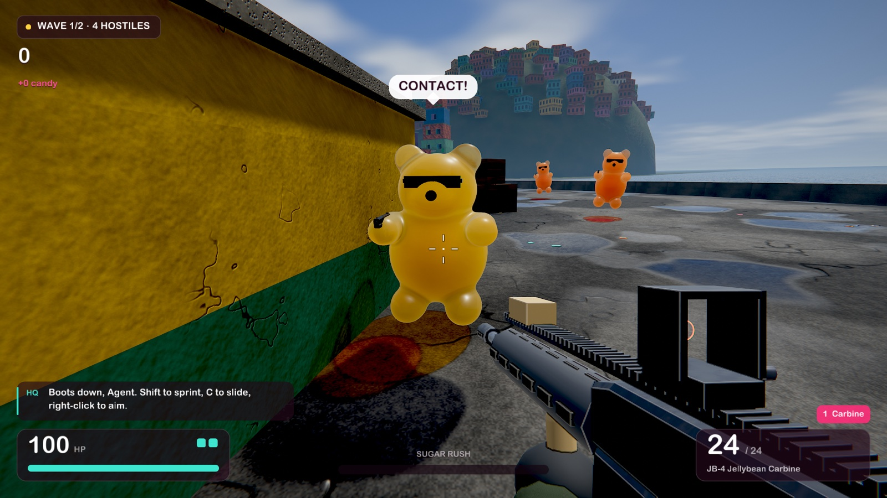
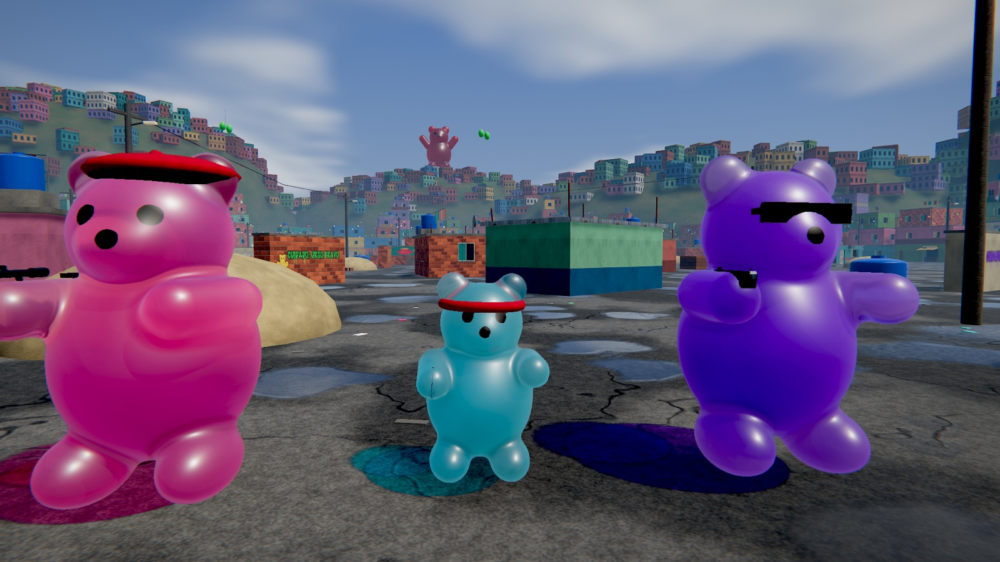
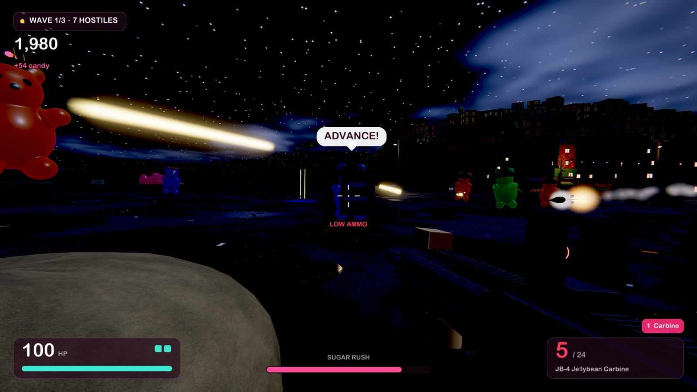
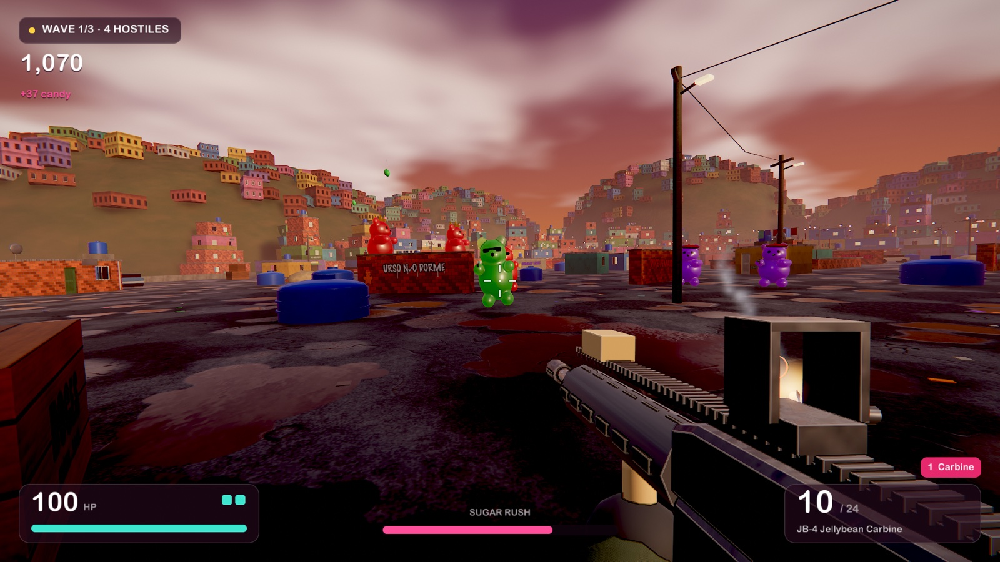
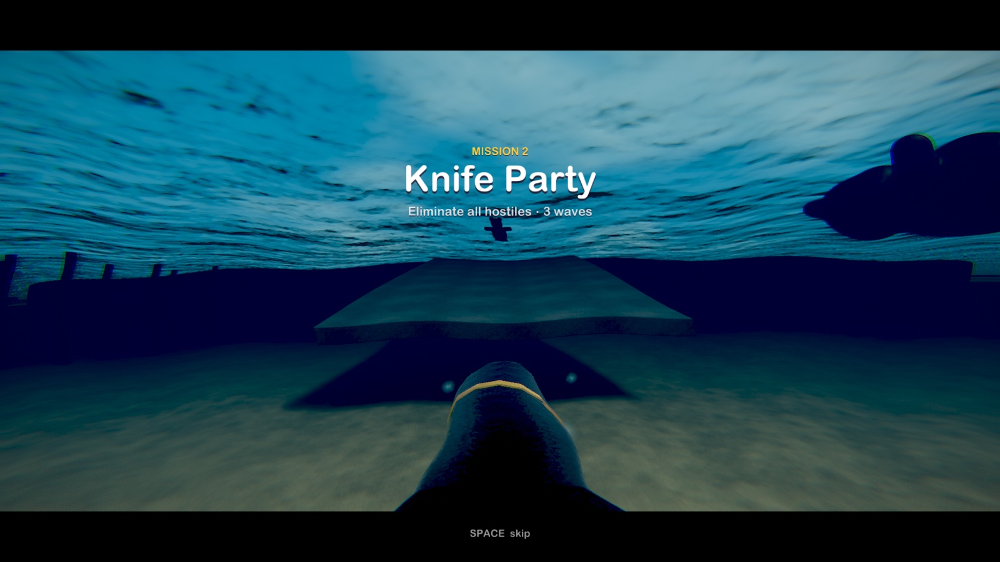
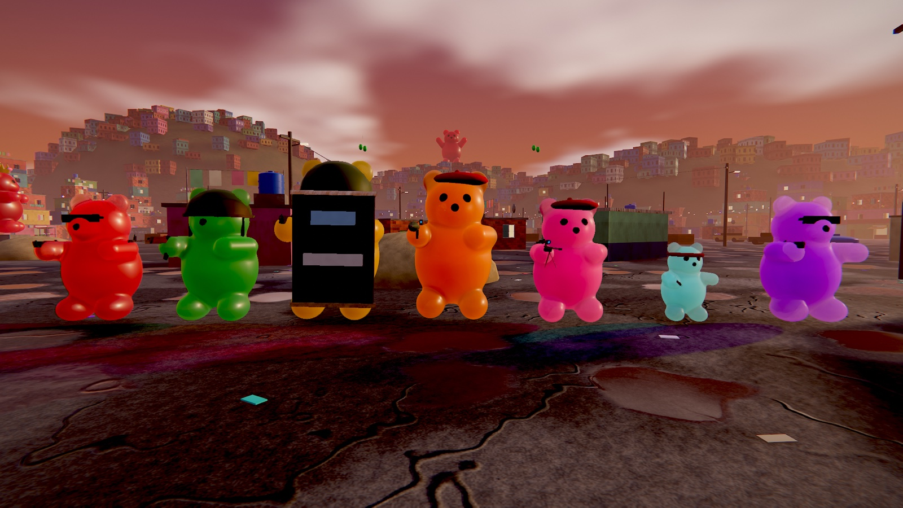
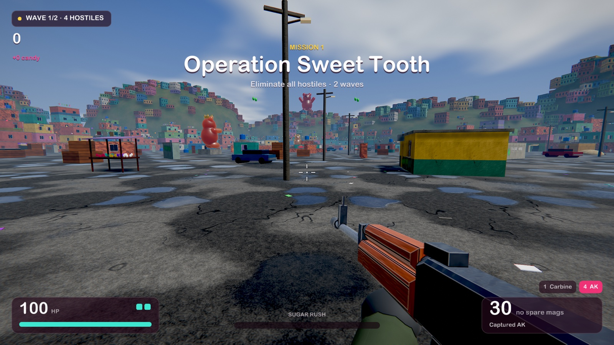

# Gummy Grove

**They have guns. You have jellybeans.**



Gummy Grove is a first-person shooter set in a gummy-bear favela. The Gummy Armed Forces have seized the Grove and they are carrying real firearms. You get a proper carbine, but the only ammunition left in town is candy.

It is a native macOS game written in Rust on a custom Metal renderer, with ray-traced shadows from Metal Performance Shaders. There are no asset files: every mesh, texture, sound and note of music is generated in code when the game starts, which takes about a second.

The setting is a homage to the Favela map from Call of Duty: Modern Warfare 2, rebuilt with candy in place of everything else. It is meant as affectionate parody and is not intended to offend anyone.

## Play

You need a Mac with Apple silicon and a [Rust toolchain](https://rustup.rs).

```bash
git clone https://github.com/jonathangarelick/gummy-grove
```

```bash
cd gummy-grove
```

```bash
cargo run --release --locked
```

| Key | Action |
| --- | --- |
| WASD | move |
| Shift | sprint |
| C | crouch, or slide while moving |
| Space | jump, climb ledges |
| Click / right click | fire / aim down sights |
| V | melee |
| E | pick up dropped weapons and armor |
| 1 2 3 4, Q, wheel | weapons |
| R | reload |
| F | Sugar Rush when the meter is full |
| Esc | pause |
| F11 / F3 | fullscreen / frame rate in the title bar |

Progress saves to `~/Library/Application Support/GummyGrove/save.json`.

## What is in it

| | |
| --- | --- |
|  |  |
|  |  |

- **A campaign of eight missions** across morning, sunset, overcast and night, plus an endless arcade mode. Objectives are to clear waves, survive the clock, hunt marked targets and bring down King Gummy.
- **Seven kinds of bear**: pistols, knives, rifles, riot shields, rockets, snipers and the King with his minigun. They take turns attacking, strafe, close in when they lose sight of you, and complain loudly.
- **Take their weapons.** Shoot a gun arm off, or just finish the bear, and it drops what it was holding. Pick it up and you have one magazine of the real thing: pistol, AK, sniper rifle, RPG or the King's minigun.
- **Three guns of your own** that fire candy: a jellybean carbine, then a gumball shotgun and a jawbreaker launcher unlocked through the campaign.
- **Movement with weight**: sprint, slide, mantle onto rooftops, lean into turns, and a weapon that trails behind your aim.
- **Sugar Rush**: fill the meter and everything slows down except you.
- **Two ways in**: by parachute over the bay, or under the water behind a diver scooter and up the boat ramp.
- **Progression**: ranks, candy to spend on upgrades, and perks such as a third slide charge or kills that explode during Sugar Rush.



## How it is drawn

The renderer is about 1,000 lines of Rust and Metal Shading Language, and the whole game about 5,300. The shaders are compiled when the game starts.

- **Ray-traced shadows and ambient occlusion.** The level goes into an `MPSTriangleAccelerationStructure`. Each frame a compute kernel generates shadow and occlusion rays at half resolution, `MPSRayIntersector` traces them, and the result is accumulated over time and cleaned up with an edge-aware blur.
- **Jelly, not plastic.** The bears are not meshes. Each one is a signed-distance shape ray-marched in the fragment shader and shaded as a clear, faintly cloudy medium: colour comes from how much jelly a ray crosses, the scene behind is refracted and blurred through the body, sunlight glows through thin parts, and the shadows they cast are tinted with a bright centre.
- **Procedural materials.** Plaster, brick, concrete, corrugated iron, wood and asphalt are generated on the CPU as albedo, normal and roughness layers. Graffiti, shop signs and murals are drawn into a decal atlas.
- **The rest of the frame**: deferred shading, a cloud-covered sky with height fog, reflective puddles and water, street lamps at night, temporal anti-aliasing, bloom with `MPSImageGaussianBlur`, filmic tone mapping, and `MPSImageLanczosScale` to bring the internal image up to the window.
- **Sound** is a small software synthesiser: every gunshot, bear voice and the adaptive music are generated on the audio thread.

On an M1 Pro a frame takes about 9 ms of GPU time in a 2880×1800 window (rendered at 1832×1144 and upscaled).



## Tests

The game tests itself without a person at the keyboard. All of these use a throwaway save file.

```bash
cargo run --release --locked -- --bot
```

An aim-bot plays all eight missions and nine arcade waves with no window and reports each outcome.

```bash
cargo run --release --locked -- --uitest --rich
```

Clicks through the menus: briefing, deploy, pause, settings, an armory purchase, arcade.

```bash
cargo run --release --locked -- --smoke 300
```

Opens the real window, plays 300 frames and prints frame timings.

```bash
cargo run --release --locked -- --shot out.png --mission 3 --t 10 --play
```

Renders one frame to a PNG. Useful flags:

| Flag | Effect |
| --- | --- |
| `--mission N`, `--t SECONDS`, `--play` | start a mission, run it for a while, let the bot play |
| `--freeze-when N` | stop time once N bears are in clear view, then take the picture |
| `--intro` | keep the insertion sequence instead of skipping it |
| `--screen map\|brief\|armory\|settings\|pause\|results` | show a menu screen |
| `--gun N`, `--give ak\|pistol\|sniper\|rpg\|minigun`, `--ads` | choose what is in your hands |
| `--lineup`, `--pal morning\|sunset\|overcast\|night`, `--noui` | a row of bears in every colour, the lighting, no menu |
| `--cam --x --y --z --yaw --pitch --fov` | place the camera by hand |
| `--w`, `--h`, `--scale` | output size and internal render scale |

## Layout

| Path | What |
| --- | --- |
| `src/gfx.rs`, `src/shaders.metal` | the renderer |
| `src/world.rs`, `src/tex.rs`, `src/mesh.rs` | the favela, procedural materials and decals, the mesh kit |
| `src/guns.rs`, `src/bear.rs` | weapon and gear models, bear poses |
| `src/game.rs`, `src/game/hud.rs` | movement, combat, bear AI, missions, HUD and menus |
| `src/meta.rs` | campaign, upgrades, perks, the save file |
| `src/audio.rs` | the synthesiser |
| `web/` | the original three.js prototype, kept for reference |

## Notes

- Apple silicon Macs only. It has been run on one machine, an M1 Pro on macOS 27.
- This is a fan project. It is not affiliated with or endorsed by Activision or the Call of Duty series, and uses none of their assets.
- Interface text uses fonts that ship with macOS (Arial Rounded, Impact, Marker Felt).
- Dependencies are locked to versions at least seven days old at the time of locking; build with `--locked`.

## License

[MIT](LICENSE).
